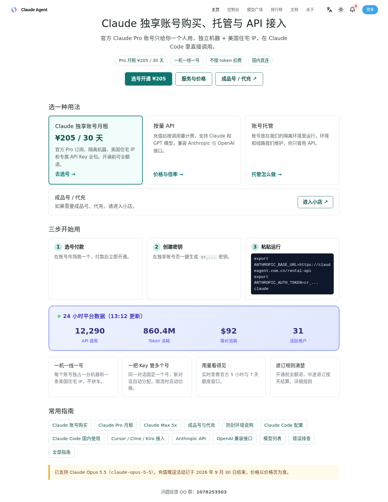

# 2026 Claude Code 国内稳定使用、防封环境与独享账号对比指南（支持 Claude Opus 5.5）

[](https://claudeagent.com.cn)
[](https://claudeagent.com.cn/console/rentals)
[](https://t.me/+aYfNuJJJ-hQ5YTg1)
[](https://t.me/ourclaudeagent_bot)

> **核心痛点直达**：国内使用 `@anthropic-ai/claude-code`、Cursor、Cline、Kiro 时，如何同时解决 **「按量 API 账单爆炸」「多人拼车丢 Prompt Cache 与抢 5h 窗口」「普通机场代充秒封号」** 三大难题？
>
> 本仓库整理了经过 20+ 生产实例长期验证的 **物理级「一机一线一号（独立隔离 VM + 美区静态住宅 IP）」** 架构方案、真实市场成本横向对比与三行命令免代理接入指南。



---

## ⚡ 三步快速开始（国内免代理直连 Claude Code）

无需安装任何第三方魔改客户端或开启全局 TUN 代理，直接使用 Anthropic 官方原版 `@anthropic-ai/claude-code`（已同步支持最新 **`claude-opus-5-5`**）：

1. **选号开通**：在 [Claude Agent 独享账号市场](https://claudeagent.com.cn/console/rentals) 挑选一个现货账号（或提交[自有账号托管](https://claudeagent.com.cn/claude-tuoguan/)）。
2. **创建密钥**：在控制台「独享账号」页一键生成专属 `cr_...` 密钥。
3. **终端运行**：

### macOS / Linux

```bash
export ANTHROPIC_BASE_URL="https://claudeagent.com.cn/rental-api"
export ANTHROPIC_AUTH_TOKEN="cr_你的专属密钥"
claude
```

### Windows PowerShell

```powershell
$env:ANTHROPIC_BASE_URL = "https://claudeagent.com.cn/rental-api"
$env:ANTHROPIC_AUTH_TOKEN = "cr_你的专属密钥"
claude
```

---

## 📊 国内 5 种 Claude Code 接入方案真实成本与风险对比

官方月付定价锚点：Claude Pro **$20/月**、Max 5x **$100/月**、Max 20x **$200/月**。针对国内无法直接绑卡支付与网络风控问题，目前市面主流方案对比如下：

| 方案类别 | 市场常见月均价 | 实际交付物与隔离模型 | 核心痛点与隐形风险 |
| :--- | :--- | :--- | :--- |
| **1. 裸代充 / 买成品号** | Pro ¥165 ~ ¥249<br>Max 5x ¥950 ~ ¥1,180 | 仅充值会员，网络与防封环境由买家自理 | **封号率极高**。本地科学上网节点跳动、多人共用机场机房 IP 极易触发风控秒封，且绝大多数代充「封号不退」。 |
| **2. 合租 / 拼车车位** | ¥300 ~ ¥500 / 人 | 2~5 人共用同一个官方号，按面板或转发分摊 | **高峰期抢额度 + 丢缓存**。同车有人跑大任务打满 5 小时窗口，其他人全部报 `429`；多人轮询还会击穿 Prompt Cache。 |
| **3. 积分镜像站 / 套餐中转** | ¥259 ~ ¥1,928 / 月 | 站内自设积分或每日名义美元限额（背后是百人共享池） | **非官方整号交付**。名字叫 Pro/Max 套餐，实际按复杂的模型倍率和缓存倍率扣站内积分，重度用几天就见底。 |
| **4. 纯按量 API 中转** | 按 Token 充值扣费 | 标准 API Key，按每次输入输出 Token 计费 | 适合低频问答。**一旦用 Claude Code 跑代码重构（单轮上下文动辄 100k+ Tokens），一天烧掉 $15~$30 家常便饭**。 |
| **5. 物理级「一机一线一号」独享月租**<br>（[**Claude Agent**](https://claudeagent.com.cn)） | **Pro ¥205 / 30 天全包**<br>Max 5x ¥250 / 周<br>Max 20x ¥500 / 周 | **1 个官方整号 + 1 台独立隔离 VM + 1 条美国静态住宅 IP + 专属直连 Key** | **不按 Token 扣费**，100% 独占该官方账号原生 5h / 7d 窗口额度；开通前随时全额退，中途退订按天结算。 |

---

## 🛡️ 为什么重度用 Claude Code 必须选「一机一线一号 + 粘性网关」？

### 1. 彻底解决环境封号：独立容器 + 固定美区静态住宅宽带 IP
Anthropic 的风控核心检测三件事：**支付卡段一致性、登录设备指纹稳定性、出口 IP 的 ASN 属性（机房 vs 住宅）**。
- 在 [Claude Agent 防封架构](https://claudeagent.com.cn/rental-security/) 中，每个账号从注册、订阅到日常 API 调用，全程固定运行在同一台独立 Linux 容器与同一条美国静态住宅宽带 IP 上。
- 你在国内电脑直接通过 HTTPS 连我们的网关入口，**本地无需挂梯子**，即使你切换国内 Wi-Fi 或手机热点，上游看到的始终是那条固定不动的美国住宅 IP。

### 2. 保住 95%+ Prompt Cache 命中率：会话粘性路由（Sticky Session）
很多开发者发现用某些共享中转站跑 Claude Code 又慢又蠢，核心原因是 **无状态轮询击穿了 Prompt Cache**。
- 在我们的[多实例池化网关](./docs/03-multi-account-sticky-pool.md)中，同一个终端会话 100% 粘性绑定到同一个独享实例。
- 如果你是全天候重度用户，租用 2~3 个独享号放入个人专属号池后，只需配置 **一把 `cr_...` 密钥**：**同一对话固定单号保缓存，新对话自动选空闲号，单号触发 5 小时限流自动无缝切换到下一个号**。

### 3. 官方 5 小时 / 7 天窗口额度实时透明
拒绝任何黑盒「站内积分」。你在控制台可以实时查看当前独享账号的 **官方 5 小时滑动窗口** 与 **7 天累计窗口** 剩余百分比，自己有没有用、用了多少一目了然。

---

## 📚 深度专题文档导航

- 📄 [01. Claude 账号多少钱一个月？独享 Pro、合租拼车、代充与按量 API 真实成本算账](./docs/01-claude-pro-max-pricing.md)
- 📄 [02. 为什么你的 Claude 账号总被封？机房 IP 风控机制与「一机一线一号」美区静态住宅 IP 详解](./docs/02-anti-ban-residential-ip.md)
- 📄 [03. 解决 Claude Code 5 小时窗口限流（429）与 Prompt Cache 丢失：多实例粘性号池架构](./docs/03-multi-account-sticky-pool.md)
- 🔧 [一键配置脚本（macOS / Linux / Windows PowerShell）](./scripts/)

---

## 🔗 官方入口与常用指南链接

| 功能入口 | 直达链接 | 说明 |
| :--- | :--- | :--- |
| **🏠 官方网站首页** | <https://claudeagent.com.cn> | 独享账号月租、账号托管与兼容 API 网关总览 |
| **🛒 独享账号选号台** | <https://claudeagent.com.cn/console/rentals> | 实时查看在售 Pro / Max 独享现货，选号即开 |
| **💰 服务与价格总览** | <https://claudeagent.com.cn/buy/> | Pro 月租 ¥205 全包、成品号、代充与按量 API 价格 |
| **🛡️ 防封环境说明** | <https://claudeagent.com.cn/rental-security/> | 一机一线一号、美区静态住宅 IP 与风控隔离细节 |
| **🖥️ 自有账号托管** | <https://claudeagent.com.cn/claude-tuoguan/> | 把你自己的 Claude 账号放入我们的隔离住宅环境运行 |
| **⚡ Claude Code 配置** | <https://claudeagent.com.cn/guides/claude-code/> | macOS / Linux / Windows 环境变量与常见排障 |
| **🔌 Cursor / Cline / Kiro** | <https://claudeagent.com.cn/guides/clients/> | 主流 AI IDE 与插件接入配置指南 |
| **📦 成品号 / 代充小店** | <https://wzyp.cn/shop/9005PR5G> | 需要独立成品号或原号代充可直接进入小店 |

---

## 💬 社区交流与实时库存通知

- **Telegram 实时库存机器人**：[@ourclaudeagent_bot](https://t.me/ourclaudeagent_bot)（支持发送 `/stock` 实时穿透查询当前数据库可秒开现货数量）
- **Telegram 官方售后交流群**：[点击加入 TG 群](https://t.me/+aYfNuJJJ-hQ5YTg1)
- **问题反馈 QQ 群**：`1078253503`
